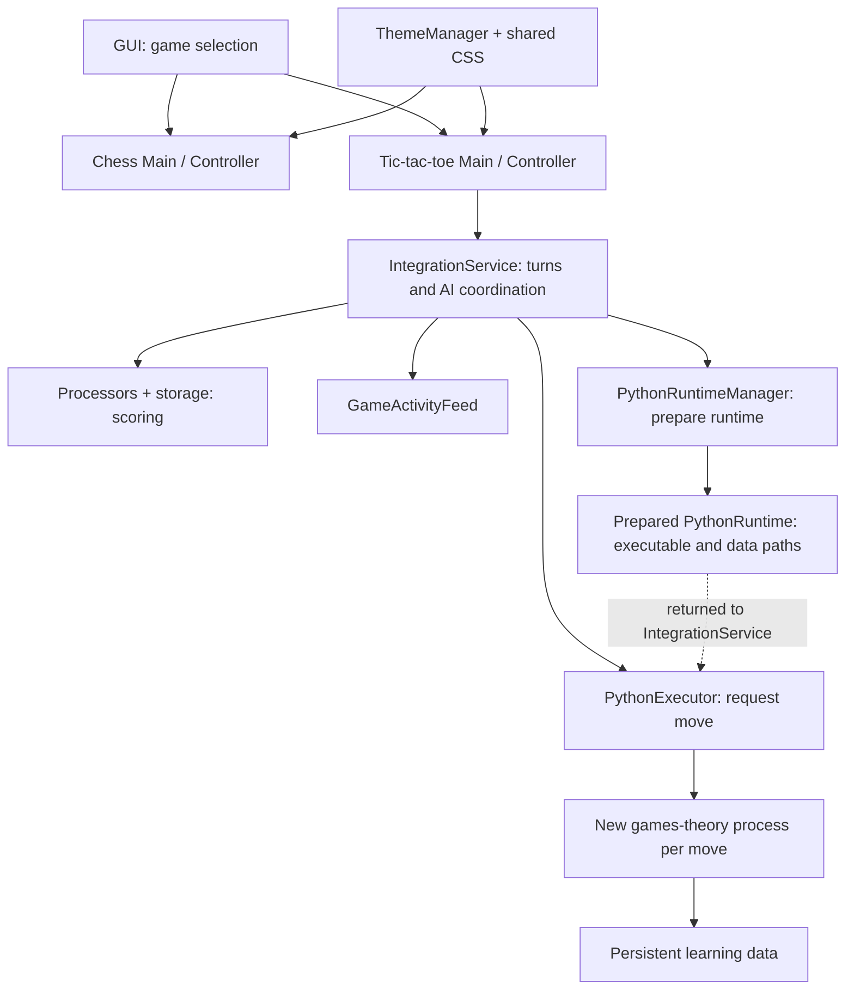
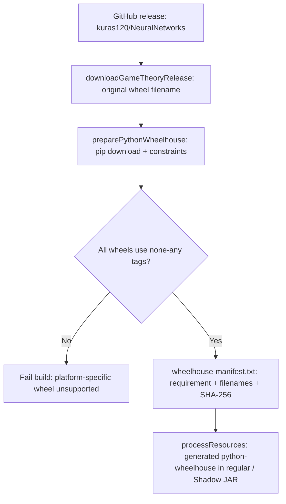
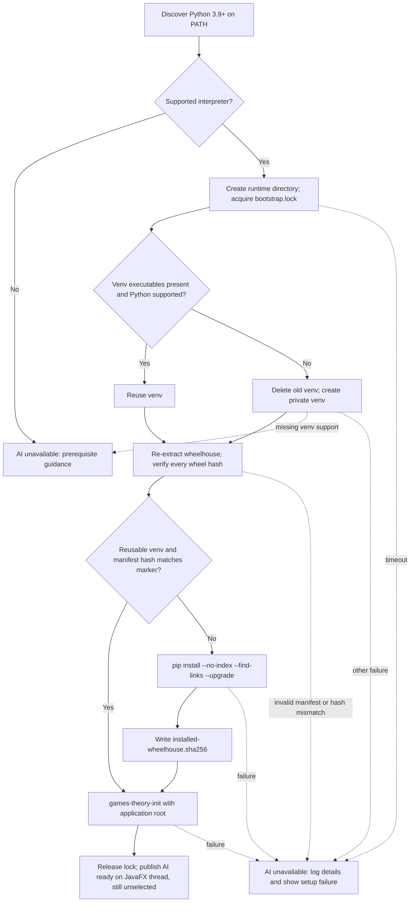

# Architecture

Java 21 / JavaFX 21 desktop application with an optional Python Q-learning
opponent. Game behavior and the move contract live in [domain docs](domain/).
Evaluated alternatives and dated evidence live in [research](research/).

| Location | Responsibility |
| --- | --- |
| `src/main/java/com/games/theory/GUI.java` | Select chess by default or tic-tac-toe with `tictactoe`. |
| `src/main/java/com/games/theory/chess/` | Board frontend and piece selection. |
| `src/main/java/com/games/theory/tictactoe/` | Turns, scoring, activity, and AI coordination. |
| `src/main/java/com/games/theory/tictactoe/integration/` | Interpreter discovery, bootstrap, and move execution. |
| `src/main/java/com/games/theory/ui/`, `src/main/resources/` | Shared themes, FXML, CSS, and packaged resources. |
| `src/main/java/com/games/theory/utils/` | Resource loading, application paths, and process execution. |
| `src/test/` | Unit tests and integration-boundary fixtures. |

## Presentation and process boundaries

| Boundary | Current design |
| --- | --- |
| Themes | Standard JavaFX controls with AtlantaFX `PrimerLight` at startup and `PrimerDark` on selection; toggle switches also come from AtlantaFX. |
| Styling | `ThemeManager` applies light mode before FXML loading and handles theme selection centrally. Shared `styles/application.css` uses semantic classes and AtlantaFX looked-up colors; deliberate chessboard colors remain legible in both themes. Theme changes preserve scenes, scores, activity, selection, and AI state. |
| Background work | Runtime preparation and AI requests use virtual threads; UI updates return through `Platform.runLater`. |
| Reset | A generation counter discards a successful move response for a previous board. Failure callbacks currently lack that guard; see [AI limitations](domain/tic-tac-toe-ai.md#known-limitations). |
| External processes | Explicit argument lists, bounded timeouts, and independent stdout/stderr consumption. |
| AI contract | One move JSON on stdout, diagnostics on stderr; see [AI domain](domain/tic-tac-toe-ai.md). |
| Failure | Unavailable Python disables optional AI. Bootstrap and move failures retain logs and show concise UI feedback. Manual play remains available. |

The intended design keeps game rules separate from UI, processes, and filesystem
work; shared utilities contain no game-specific decisions. Small collaborators
own discovery, environment preparation, installation, parsing, and command
execution. `IntegrationService` currently also owns JavaFX controls and game
state, so this separation is partial. Process and resource interfaces allow
infrastructure replacement in tests.

## Build and local verification

Use JDK 21 and Python 3.9+ with `pip`; runtime setup also needs `venv`.
Build-time wheel preparation accesses GitHub and the Python package index.

| Command / setting | Purpose |
| --- | --- |
| `./gradlew run` | Launch chess. |
| `./gradlew run --args='tictactoe'` | Launch tic-tac-toe. |
| `./gradlew test` | JUnit tests and JaCoCo report. |
| `./gradlew clean build` | Full local build; also used in CI. |
| `./gradlew shadowJar` | Build the application JAR. |
| `GAME_THEORY_VERSION` in `gradle.properties` | Pin the backend release (currently `0.0.3`). |
| `-PPYTHON_COMMAND=python3` | Override Gradle's Python command; runtime discovery is separate. |
| `config/python-wheelhouse-constraints.txt` | Pin backend dependency constraints. |
| `.github/workflows/build-workflow.yml` | Build on `ubuntu-latest` with JDK 21 and Python 3.14; upload coverage. Python 3.9 remains the runtime minimum, but CI does not exercise it. |

Keep tests deterministic by replacing process, filesystem, time, and discovery
boundaries as needed. Changes to rules, parsing, persistence, paths, command
construction, or state transitions need relevant coverage, including malformed
output, non-zero exits, timeouts, unavailable runtimes, invalid moves, and stale
callbacks. Record manual or cross-platform checks still outstanding. Changes to
UI need manual light/dark, keyboard-focus, disabled-state, and layout checks.
Generated `build/` and `.gradle/` content is disposable. Repeatable verification
helpers belong under `scripts/` when needed; this checkout has no such directory.

## Python packaging and startup

Build-time dependency flow (`libs.gradle`):

The manifest records the exact `name==version` requirement from wheel metadata
and every dependency wheel's filename and SHA-256. Introducing native wheels
requires a separate packaging design. No virtual environment is packaged.

Runtime flow (`PythonRuntimeManager.prepare`, on a virtual thread):

Windows discovery tries `py -3`, `python3`, then `python`; other systems try
`python3`, then `python`. Discovery runs on every preparation, even when a venv
exists. Executables live in `venv/Scripts/*.exe` on Windows and `venv/bin/`
elsewhere. The lock is released on success or failure after acquisition.

| Operation | Current timeout |
| --- | --- |
| Interpreter version check / bootstrap lock acquisition | 10 seconds each |
| Venv creation / pip installation / initialization | 2 minutes each |
| AI move | 1 minute |

Every preparation re-extracts and verifies wheels; only installation is skipped
when the reusable venv and marker match. Initialization still runs. Dependency
updates preserve learned data. Runtime installation needs no network, but a
compatible system Python with `venv` is required. Missing/unsupported Python and
missing `venv` receive prerequisite guidance; other preparation failures receive
restart guidance and technical logs.

| Platform | Application root |
| --- | --- |
| Windows | `%LOCALAPPDATA%/GamesTheoryAI`, falling back to `~/AppData/Local/GamesTheoryAI` |
| macOS | `~/Library/Application Support/GamesTheoryAI` |
| Linux | `$XDG_DATA_HOME/GamesTheoryAI`, falling back to `~/.local/share/GamesTheoryAI` |

The `runtime/` child holds the lock, wheelhouse, marker, and venv; `data/` holds
persistent learning data. Both CLI initialization and moves receive the
application root explicitly, outside the repository and packaged resources.
A standalone backend is a [research option](research/python-backend-delivery-options.md),
not the current delivery mechanism.
