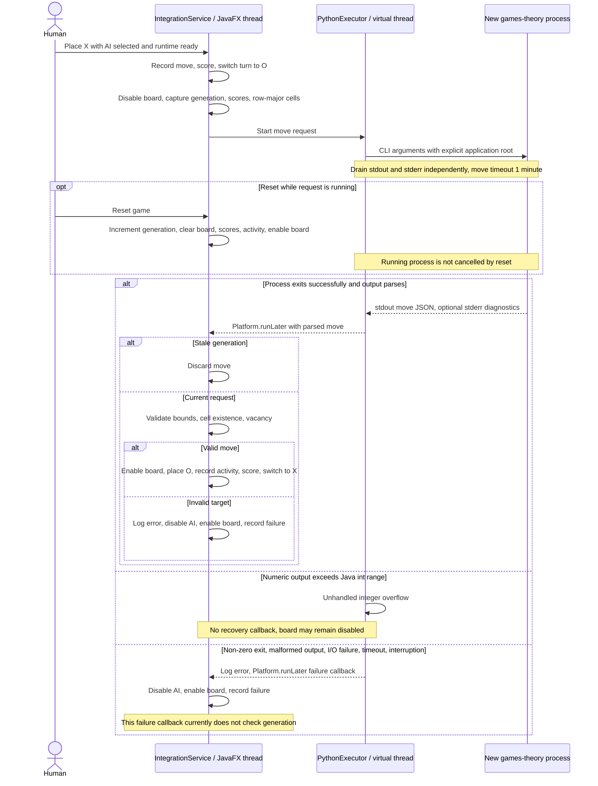

# Tic-tac-toe AI domain

Optional Q-learning opponent for `O`; the human plays `X`. The application
consumes moves without implementing the learning algorithm. Board rules,
scoring, turns, and reset belong to the [tic-tac-toe domain](tic-tac-toe.md).
See [architecture](../architecture.md) for packaging and runtime preparation.

Reset discards a successful response for the previous board. It does not cancel
the process or erase learned data.

## Move contract

| Part | Contract |
| --- | --- |
| Invocation | `games-theory --config <application-root> <X-score> <O-score> <cells...>` |
| Cells | Row-major order; `X`, `O`, or `N` for empty. A 4 × 4 board supplies 16 cells after the two scores. |
| Stdout | Exactly one JSON object, e.g. `{"x": 2, "y": 3}`; integer coordinates in `x`, `y` order. |
| Coordinates | Zero-based: `x` is column, `y` is row. |
| Stderr | Diagnostics; output alone does not invalidate a successful command. |
| Rejection | Non-zero exit, malformed output, out-of-range coordinates, missing or occupied cell. |
| Parsing limits | Whole trimmed stdout must match the `x`, then `y` integer pattern, without extra fields or text; coordinates must fit Java `int`. |

## Availability and feedback

| State | Player experience |
| --- | --- |
| Preparing | Setup starts when tic-tac-toe opens; AI is disabled and unselected. |
| Ready | AI can be enabled by the player; it stays unselected after preparation. |
| Unavailable | Disabled option with installation/restart guidance; manual play and chess remain available. |
| Handled move failure | Error is logged, AI is disabled, the board becomes interactive, and the activity feed records a friendly failure; integer overflow is an exception (below). |

## Known limitations

The failure callback from `PythonExecutor` does not check request generation,
so an older request that fails after reset can disable AI in the new game.
Integer coordinates outside Java `int` range throw an unchecked parsing error;
that path is not handled by the `AiException` recovery callback. Follow-up fixes
are tracked in [INBOX](../../INBOX.md).
